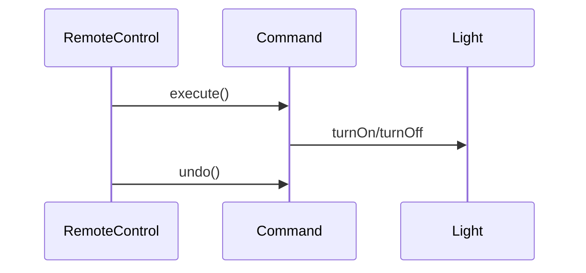

# Command

## Intenção

Encapsular uma solicitação como objeto, permitindo parametrizar clientes, enfileirar operações e suportar **desfazer (undo)**.

## Problema

O controle remoto deve acionar dispositivos diferentes sem conhecer detalhes de cada um; trocar o botão significa trocar o comando, não o invocador.

## Analogia

Pedido em restaurante: o garçom (invocador) leva o pedido (comando) à cozinha (receptor) sem cozinhar ele mesmo.

## Quando usar

1. Fila de tarefas ou macros (undo/redo).
2. Desacoplar UI de lógica de negócio.
3. Log e replay de operações.

## Quando evitar

- Operações simples sem necessidade de histórico ou fila.
- Overhead de objeto para cada clique trivial.

## Participantes

- `Command` — interface `execute` / `undo`
- `LightOnCommand`, `LightOffCommand` — comandos concretos
- `Light` — receptor
- `RemoteControl` — invocador
- `CommandDemo` — `main`

## Trade-offs

| Prós | Contras |
|------|---------|
| Invocador desacoplado do receptor | Muitas classes para comandos pequenos |
| Undo/redo natural | Estado para undo pode ser complexo |

## Diagrama



## Executar

```bash
mvn compile
java -cp target/classes behavioral.command.CommandDemo
```

**Saída esperada:**

```
Luz ligada
Luz desligada
Luz ligada
Luz desligada
```

## Como contribuir

Veja [CONTRIBUTING.md](../../../../../CONTRIBUTING.md) na raiz do repositório.
