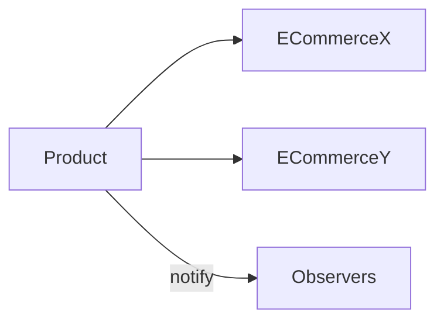

# Observer

## Intenção

Definir dependência um-para-muitos: quando o estado do sujeito muda, todos os observadores são notificados automaticamente.

## Problema

O preço de um produto mudou e vários e-commerces precisam reagir sem o produto conhecer cada loja.

## Analogia

Newsletter: você se inscreve; quando há novidade, todos os inscritos recebem o aviso.

## Quando usar

1. Eventos de domínio (pedido pago, estoque baixo).
2. UI reativa a mudanças de modelo.
3. Integrações leves entre módulos desacoplados.

## Quando evitar

- Ordem de notificação crítica sem controle explícito.
- Observadores fazendo trabalho pesado na thread do emissor (risco de bloqueio).
- Risco de vazamento se não remover observadores (ciclo de vida).

## Participantes

- `Subject` — registro e notificação
- `Observer` / `ObserverInterface` — observador
- `Product` — sujeito concreto
- `ECommerceX`, `ECommerceY` — observadores
- `Observer` (classe) — `main`

## Trade-offs

| Prós | Contras |
|------|---------|
| Baixo acoplamento emissor/consumidor | Notificações em cascata difíceis de rastrear |
| Adicionar observadores sem mudar sujeito | Cuidado com duplicidade e concorrência em apps reais |

## Diagrama



## Executar

```bash
mvn compile
java -cp target/classes behavioral.observer.Observer
```

**Saída esperada:**

```
Updating price product in ECommerceX...
Updating price product in ECommerceY...
```

## Como contribuir

Veja [CONTRIBUTING.md](../../../../../CONTRIBUTING.md) na raiz do repositório.
