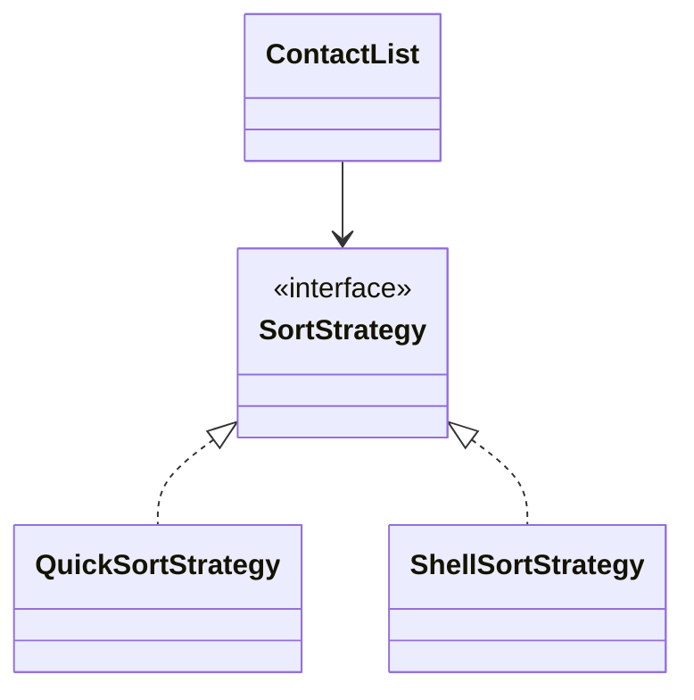

# Strategy

## Intenção

Definir uma família de algoritmos, encapsular cada um e torná-los **intercambiáveis** em tempo de execução.

## Problema

A lista de contatos pode ser ordenada com algoritmos diferentes; o contexto não deve fixar um único método de ordenação.

## Analogia

Apps de navegação: você escolhe rota mais rápida, mais barata ou sem pedágio — o mapa é o mesmo, a estratégia muda.

## Quando usar

1. Várias variantes de um algoritmo (ordenação, imposto, frete).
2. Evitar `if/else` ou `switch` grandes no contexto.
3. Trocar comportamento em runtime conforme configuração.

## Quando evitar

- Só existe um algoritmo estável.
- A troca de estratégia é rara e um método privado resolve.

## Participantes

- `SortStrategy` — estratégia
- `QuickSortStrategy`, `ShellSortStrategy` — estratégias concretas
- `ContactList` — contexto que usa a estratégia
- `Strategy` — `main`

## Trade-offs

| Prós | Contras |
|------|---------|
| Open/closed para novos algoritmos | Mais classes |
| Contexto mais limpo | Cliente precisa conhecer estratégias disponíveis |

## Diagrama



## Executar

```bash
mvn compile
java -cp target/classes behavioral.strategy.Strategy
```

**Saída esperada:**

```
Sort with QuickSortStrategy...
Sort with ShellSortStrategy...
```

## Como contribuir

Veja [CONTRIBUTING.md](../../../../../CONTRIBUTING.md) na raiz do repositório.
