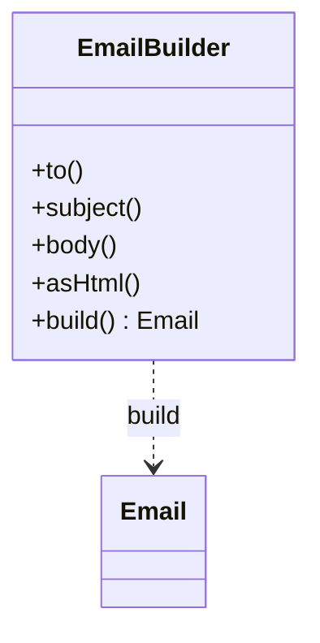

# Builder

## Intenção

Separar a **construção** de um objeto complexo da sua **representação**, permitindo o mesmo processo de montagem criar configurações diferentes.

## Problema

Objetos com muitos campos opcionais levam a construtores longos ou muitos overloads; o Builder torna a montagem legível e validável.

## Analogia

Montar um sanduíche no balcão: você escolhe pão, recheio e molhos em passos, e só no final “fecha o pedido”.

## Quando usar

1. Muitos parâmetros opcionais (e-mails, relatórios, DTOs).
2. Objeto imutável que exige validação antes de existir.
3. Mesma sequência de passos com variações (HTML vs texto plano).

## Quando evitar

- Poucos campos obrigatórios — um construtor simples basta.
- Quando records ou factory methods já deixam o código claro.

## Participantes

- `Email` — produto imutável
- `EmailBuilder` — monta o produto passo a passo
- `BuilderDemo` — dois e-mails com configurações diferentes

## Trade-offs

| Prós | Contras |
|------|---------|
| Código de montagem legível | Mais classes |
| Validação centralizada em `build()` | Pode duplicar campos com o produto |

## Diagrama



## Executar

```bash
mvn compile
java -cp target/classes creational.builder.BuilderDemo
```

**Saída esperada (duas linhas):**

```
Email{to='aluno@example.com', subject='Bem-vindo ao catálogo', html=false, bodyLength=61}
Email{to='maintainer@example.com', subject='Build falhou', html=true, bodyLength=22}
```

## Como contribuir

Veja [CONTRIBUTING.md](../../../../../CONTRIBUTING.md) na raiz do repositório.
