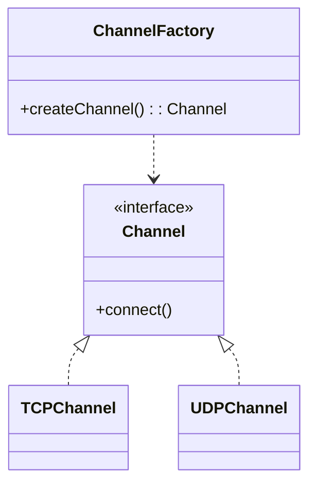

# Factory Method

## Intenção

Definir uma interface para criar objetos, mas deixar as subclasses (ou fábricas concretas) decidir qual classe instanciar.

## Problema

O cliente precisa de canais de comunicação (`TCP`, `UDP`) sem conhecer os detalhes de construção de cada implementação.

## Analogia

Como escolher o transporte no balcão: você pede “envio rápido” ou “envio econômico” e o atendente (fábrica) entrega o serviço certo.

## Quando usar

1. Criação de objetos varia conforme configuração ou tipo.
2. Você quer isolar o cliente das classes concretas.
3. Um ponto central deve registrar novos tipos sem alterar o código cliente.

## Quando evitar

- A criação é trivial (use `new` direto).
- Só existe uma implementação estável e sem variação futura.

## Participantes

- `Channel` — produto
- `TCPChannel`, `UDPChannel` — produtos concretos
- `ChannelFactory` — cria o canal adequado
- `ClientTCP`, `ClientUDP` — clientes que usam a fábrica

## Trade-offs

| Prós | Contras |
|------|---------|
| Desacopla cliente da implementação | Mais classes e indireção |
| Facilita adicionar novos canais | Pode ser excessivo para um único tipo |

## Diagrama



## Executar

```bash
mvn compile
java -cp target/classes creational.factory.Factory
```

**Saída esperada:**

```
Connected TCP
Connected UDP
```

## Como contribuir

Veja [CONTRIBUTING.md](../../../../../CONTRIBUTING.md) na raiz do repositório.
