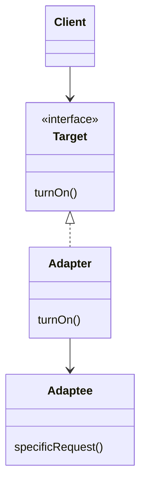

# Adapter

## Intenção

Converter a interface de uma classe em outra interface esperada pelo cliente, permitindo que classes trabalhem juntas sem alterar o código original.

## Problema

O cliente espera um projetor com `turnOn()`, mas o equipamento Samsung expõe uma API incompatível.

## Analogia

Adaptador de tomada: o aparelho não muda; o adaptador traduz o formato da fiação.

## Quando usar

1. Integrar biblioteca legada com interface própria.
2. Reutilizar classe sem modificá-la (fechada ou de terceiros).
3. Unificar várias APIs sob um contrato comum para o cliente.

## Quando evitar

- Você controla o código-fonte e pode alterar a API diretamente.
- A camada adaptadora cresce demais (considere facade ou redesign).

## Participantes

- `AdapterProjectorSamsung` — adaptador que implementa a interface esperada
- `ProjectorSamsung` — API incompatível (adaptada)
- `Adapter` — `main` que usa o adaptador

## Trade-offs

| Prós | Contras |
|------|---------|
| Reuso sem mudar código legado | Camada extra de indireção |
| Cliente permanece simples | Múltiplos adaptadores podem proliferar |

## Diagrama



## Executar

```bash
mvn compile
java -cp target/classes structural.adapter.Adapter
```

**Comportamento:** o adaptador delega para o projetor Samsung; a saída no console pode estar vazia neste exemplo mínimo — confira que não há exceção e que `turnOn()` foi invocado.

## Como contribuir

Veja [CONTRIBUTING.md](../../../../../CONTRIBUTING.md) na raiz do repositório.
