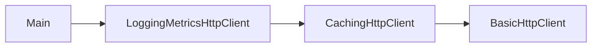

# Decorator

## Intenção

**Adicionar responsabilidades sem alterar a classe original**, envolvendo o objeto em camadas que compartilham a mesma interface.

## Ideia-chave

Envolve o objeto e acrescenta comportamento. Prefira **composição** a uma cadeia difícil de entender — mas lembre que camadas demais também confundem; use só o que a demonstração precisa.

## Problema

Um cliente HTTP simples atende requisições, mas em produção você quer **cache** e **log com tempo de resposta** sem mudar `BasicHttpClient` e sem criar subclasses para cada combinação.

## Modelo mental

```ascii
  Objeto base  -->  Cache  -->  Log + métrica
                 camadas combináveis
```

Na 1ª chamada a API é acessada; na 2ª, o cache evita ir de novo à base (o log+métrica ainda envolve a chamada).

## Quando usar

1. Adicionar **cache** a um cliente HTTP (ou repositório).
2. Adicionar **logs e métricas** a um serviço sem alterar a implementação core.
3. Combinar comportamentos opcionais (compressão, criptografia) em fluxos de dados.

## Quando evitar

- Cadeia longa de decorators difícil de depurar.
- Um único `if` ou estratégia já deixa o fluxo óbvio.

## Participantes

| Papel | Classe |
|-------|--------|
| Componente | `HttpClient` |
| Objeto base | `BasicHttpClient` |
| Decorator abstrato | `HttpClientDecorator` |
| Cache | `CachingHttpClient` |
| Log + métrica | `LoggingMetricsHttpClient` |
| Demo | `Decorator` (`main`) |

## Trade-offs

| Prós | Contras |
|------|---------|
| Combina camadas na ordem que precisar | Ordem importa (ex.: cache por fora ou por dentro) |
| Não mexe na classe original | Várias classes pequenas |

## Diagrama



## Executar

```bash
mvn compile
java -cp target/classes structural.decorator.Decorator
```

**Saída esperada (trecho):**

```
--- 1ª chamada ---
[cache] miss: /users/1
[base] chamando API: /users/1
[log+métrica] /users/1 em ... ms
--- 2ª chamada (mesma URL) ---
[cache] hit: /users/1
[log+métrica] /users/1 em ... ms
```

Na segunda chamada não aparece `[base] chamando API` — o cache interceptou antes da API real.

## Como contribuir

Veja [CONTRIBUTING.md](../../../../../CONTRIBUTING.md) na raiz do repositório.
