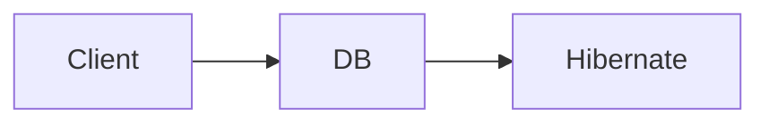

# Facade

## Intenção

Oferecer uma **interface simplificada** para um subsistema complexo, escondendo a coordenação entre várias classes.

## Problema

Conectar ao banco exige instanciar `Hibernate` e seguir instruções complexas; o cliente quer apenas “conectar”.

## Analogia

Recepção de hotel: você pede um serviço; a recepção coordena limpeza, cozinha e manutenção sem você falar com cada setor.

## Quando usar

1. API de alto nível sobre vários serviços internos.
2. Reduzir acoplamento do cliente a detalhes de infraestrutura.
3. Camada de entrada em bibliotecas legadas.

## Quando evitar

- A facade virar um “objeto Deus” com toda a lógica de negócio.
- Quando o cliente precisa de controle fino sobre cada subsistema.

## Participantes

- `Facade` / `DB` — ponto de entrada simplificado
- `Hibernate` — subsistema com operações complexas

## Trade-offs

| Prós | Contras |
|------|---------|
| Cliente mais simples | Pode esconder demais e dificultar uso avançado |
| Desacopla subsistemas | Risco de centralizar demais |

## Comparação

**Sem facade (conceitual):** `new Hibernate().complexInstructionsToAccessDatabase()`

**Com facade:** `new DB().connect()` — uma chamada expressa a intenção.

## Diagrama



## Executar

```bash
mvn compile
java -cp target/classes structural.facade.Facade
```

**Saída esperada:**

```
true
```

## Como contribuir

Veja [CONTRIBUTING.md](../../../../../CONTRIBUTING.md) na raiz do repositório.
