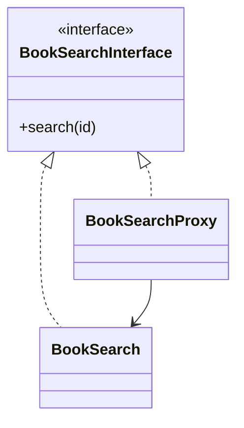

# Proxy

## Intenção

Fornecer um **substituto** ou placeholder que controla o acesso a outro objeto (lazy loading, cache, controle de permissão).

## Problema

Buscar livros no banco é caro; o proxy pode devolver do cache quando possível.

## Analogia

Assistente que só liga para o gerente quando a resposta não está na pasta dele.

## Quando usar

1. Lazy initialization de objetos pesados.
2. Cache de resultados de operações custosas.
3. Controle de acesso ou logging transparente.

## Quando evitar

- A indireção não traz benefício mensurável.
- Proxy duplica interface sem política clara de acesso.

## Participantes

- `BookSearchInterface` — sujeito comum
- `BookSearch` — objeto real
- `BookSearchProxy` — proxy com cache
- `Proxy` — `main`

## Trade-offs

| Prós | Contras |
|------|---------|
| Otimização e controle transparentes | Latência extra na primeira chamada |
| Cliente não muda | Mais classes |

## Diagrama



## Executar

```bash
mvn compile
java -cp target/classes structural.proxy.Proxy
```

**Saída esperada (trecho):**

```
Get from cache example
...
Get from database example
...
```

## Como contribuir

Veja [CONTRIBUTING.md](../../../../../CONTRIBUTING.md) na raiz do repositório.
